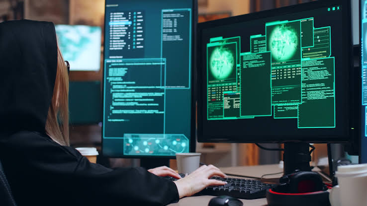

# Anàlisi forense

***

<figure><figcaption></figcaption></figure>

## Preparació: afegeix un disc d’auditoria

Amb la màquina virtual apagada, afegeix un segon disc virtual des de VirtualBox o VMware a la màquina Kali Linux.

Assigna-li prou capacitat per contenir una imatge completa del disc principal i els resultats de l’anàlisi. Per simplificar, conserva una única imatge i analitza-la sense modificar-la.

Afegeix els passos detallats de configuració

<figure><figcaption></figcaption></figure>

<figure><figcaption></figcaption></figure>

***

Inicia Kali, identifica el disc nou amb lsblk, crea-hi una partició i formata-la. Comprova que és el disc nou abans de formatar-lo. Assigna-li l’etiqueta AUDITORIA i crea-hi aquestes carpetes: imatge/,registres/,resultats/

<figure><figcaption></figcaption></figure>

***

FORMATAR EL DISC

<figure><figcaption></figcaption></figure>

CREAR PUNT DE MUNTATGE I MUNTAR

<figure><figcaption></figcaption></figure>

CREAR CARPETES DEMANADES

<figure><figcaption></figcaption></figure>

***

Evidència 1: Simulació, adquisició i anàlisi

### PAS 1: Crea, modifica i elimina fitxers

\
Crea la carpeta i els fitxers

<figure><figcaption></figcaption></figure>

Desa una imatge JPEG de prova (descarrega’n una o copia’n una) com a \~/cas\_forense/imatge.jpg

<figure><figcaption></figcaption></figure>

Registra els hashes abans d’eliminar res:

<figure><figcaption></figcaption></figure>

Eliminar secret\_atac.txt

<figure><figcaption></figcaption></figure>

Modificar document.txt

<figure><figcaption></figcaption></figure>

Cambiar permisos

<figure><figcaption></figcaption></figure>

Eliminar la imagen

<figure><figcaption></figcaption></figure>

Comprobar

<figure><figcaption></figcaption></figure>

## Pas 2: manipulació temporal

Crea el fitxer i desa les metadades d’abans

<figure><figcaption></figcaption></figure>

Canvia les dates

<figure><figcaption></figcaption></figure>

Desa les metadades de després

<figure><figcaption></figcaption></figure>

## Pas 3: Desa els registres disponibles

\
Data i hora de la recollida

<figure><figcaption></figcaption></figure>

timedatectl

<figure><figcaption></figcaption></figure>

Registres amb journalctl

<figure><figcaption></figcaption></figure>

Historial d’ordres

<figure><figcaption></figcaption></figure>

Comprova que s’ha desat tot

<figure><figcaption></figcaption></figure>

Abans d’apagar Kali

<figure><figcaption></figcaption></figure>

 

## Pas 4: adquireix el disc principal amb dd

\
Apaga Kali i inicia la màquina virtual amb una ISO de Kali en mode Live.

<figure><figcaption></figcaption></figure>

<figure><figcaption></figcaption></figure>

Obre un terminal i identifica els discos

<figure><figcaption></figcaption></figure>

muntar només AUDITORIA

<figure><figcaption></figcaption></figure>

Executa el dd

<figure><figcaption></figcaption></figure>

Comprova el resultat

<figure><figcaption></figcaption></figure>

\
Pas 5: hash i anàlisi de la imatge
----------------------------------

Calcula el hash SHA-256 de kali.dd

<figure><figcaption></figcaption></figure>

No modifica el contingut, així que el hash no canvia. 

Torna a iniciar Kali des del disc principal

<figure><figcaption></figcaption></figure>

Identifica i munta AUDITORIA

.png>)

Comprova si ja tens el hash

<figure><figcaption></figcaption></figure>

Calcula el hash

<figure><figcaption></figcaption></figure>

Protegeix la imatge contra escriptura

<figure><figcaption></figcaption></figure>

Buscar document.txt

<figure><figcaption></figcaption></figure>

Recuperar el contingut de document.txt

<figure><figcaption></figcaption></figure>

Metadades de prova\_temps.txt

<figure><figcaption></figcaption></figure>

Buscar entrades eliminades

<figure><figcaption></figcaption></figure>

cercar INCIDENT\_AULA\_2026

<figure><figcaption></figcaption></figure>

Recuperar la JPEG amb PhotoRec

<figure><figcaption></figcaption></figure>

<figure><figcaption></figcaption></figure>

<figure><figcaption></figcaption></figure>

<figure><figcaption></figcaption></figure>

calculat correctament el SHA-256 de la JPEG recuperada

i comparacio amb inicial

<figure><figcaption></figcaption></figure>

A la teva captura, el hash original de imatge.jpg és: d82354edc07776dcf3b76da3db275bd00897b6dd071ce13f8fb24e2d2aae655129

El hash de la JPEG recuperada és: bb4478bec97ee18e405e6a8b75f8491323221f1f891c9c53fa9cbc379e83503

Comparació del hash de la imatge recuperada

Després de recuperar una imatge JPEG amb PhotoRec, he calculat el seu hash SHA-256 amb l'ordre `sha256sum` i l'he comparat amb el hash original registrat abans d'eliminar el fitxer.

Els dos hashes són diferents. Per tant, no es pot confirmar que el fitxer recuperat sigui idèntic a la imatge original. Aquesta comparació permet comprovar la integritat del fitxer recuperat.

STRINGS I GREPS

<figure><figcaption></figcaption></figure>

## Evidència 2: Reconstrucció i informe 

**Línia de temps**

Accions simulades (sistema instal·lat, EDT, 20/10/2026)Accions simulades (sistema instal·lat, EDT, 20/10/2026)

<figure><figcaption></figcaption></figure>

**Recollida de dades**

**04:09:49 a 04:11**: es desen data, `timedatectl`, `journalctl` i historial. Font: `registres/`. Demostra l’hora del sistema, però amb **NTP inactiu i rellotge no sincronitzat**.

**Adquisició (Kali Live, UTC)**

* **10:09:50 a 10:11:28**: `dd` de `/dev/sdb` a `kali.dd`. Font: `dd_inici/dd_fi/dd_resultat.txt`. Demostra una còpia de 86.000.000.000 bytes (80 GiB), amb 20503+1 registres entrats i sortits.
* **10:12:39**: hash inicial de `kali.dd`: `88cdfb99…a9c3`.

**Anàlisi (Kali instal·lat)**

* **06:27:52 EDT (10:27:52 UTC)**: hash final de `kali.dd`: idèntic al d’abans.
* **Anàlisi**: `mmls` mostra la partició Linux a l’offset 2048. `fls` troba `document.txt` (inodes 700765 i 700760) i `prova_temps.txt` (700721). `icat 700765` recupera “Lorem ipsum / contingut modificat”. `istat 700721` confirma les dates falsificades.

En el meu cas\
**Atenció amb les dates de `kali.dd`**: el fitxer té data del 20/10 06:11 EDT perquè és el moment de **crear la imatge**, no de les accions. Les dates reals de les accions són les de dins de la imatge (03:43–04:08).

#### Pas 2: Integritat

* **Hash inicial**: `88cdfb99dd42f8510c9aecb6b67beacff8dc89408a59791c6e995e925023a9c3`
* **Hash final**: `88cdfb99dd42f8510c9aecb6b67beacff8dc89408a59791c6e995e925023a9c3`

**Coincideixen.** Vol dir que la imatge **no s’ha modificat** durant l’anàlisi (ni per mont, ni per error) i que les proves són fiables. Si no coincidissin, la imatge estaria alterada i no serviria com a prova.

### Pas 3: Informe i cadena de custòdia

**Què he fet:** he creat tres fitxers (`secret_atac.txt`, `document.txt` i `imatge.jpg`), n’he esborrat dos, he modificat `document.txt` i he canviat els permisos. També he creat `prova_temps.txt` i li he posat dates del 2018.

**Còpia del disc:** amb Kali Live he comprovat amb `lsblk` quin era el disc principal (`/dev/sdb`) i he fet la còpia amb:\
`sudo dd if=/dev/sdb of=/mnt/auditoria/imatge/kali.dd bs=4M status=progress conv=fsync`

**Hash:** abans i després de l’anàlisi dona el mateix (`88cdfb99…a9c3`), així que la imatge no ha canviat.

**Eines:** `dd`, `sha256sum`, `stat`, `touch`, `journalctl`, Sleuth Kit (`fls`, `istat`, `icat`), `strings`, `grep` i PhotoRec.

**Què he trobat:**

* He recuperat el contingut de `document.txt`.
* He vist que les dates de `prova_temps.txt` eren falses: diu 2018, però la data de canvi és del 2026.
* Els registres guarden les ordres que vaig fer.

**Limitacions:**

* No he pogut recuperar `secret_atac.txt`.
* PhotoRec no guarda els noms, així que no puc assegurar que el JPEG recuperat sigui el meu.
* El rellotge no estava sincronitzat i hi ha dues zones horàries.
* Només he fet el hash de la imatge, no del disc original.

**Línia de temps:** és la imatge de l’apartat anterior.

**Tres mesures:**

1. Activar NTP, perquè el rellotge anava desincronitzat.
2. Fer hash del disc original i de la còpia, per poder demostrar que són iguals.
3. Fer còpies de seguretat i usar `auditd`, perquè no he pogut recuperar `secret_atac.txt`.

**Cadena de custòdia:** jo, Marc Jurado, he creat la prova, he fet la còpia, he calculat el hash i he analitzat la imatge només en lectura. El hash final coincideix amb l’inicial. Tot ha quedat guardat al disc `AUDITORIA`.

