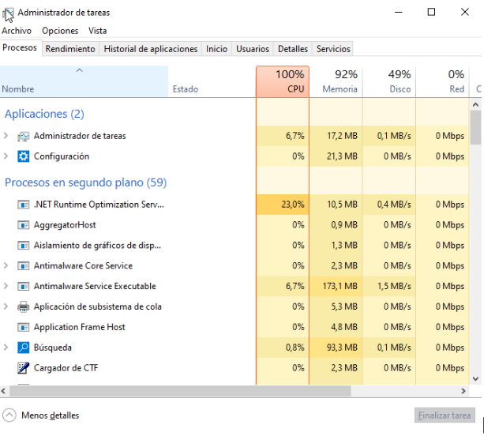

# Usuaris, perfils i seguretat del sistema

## Activitat: Usuaris, perfils i seguretat del sistema

### Apartat 1. Usuaris existents

#### WINDOWS 10

1. **Identificar l'usuari actual:** comprovar amb quin usuari he iniciat sessió a Windows.
2. **Llistar els usuaris locals:** obtenir una llista de tots els comptes d'usuari que hi ha a l'ordinador.
3. **Consultar els usuaris gràficament:** trobar els mateixos comptes mitjançant les eines d'administració de Windows.
4. **Diferenciar els comptes:** identificar quins usuaris he creat jo i quins han estat creats automàticament pel sistema.
5. **Comprovar els comptes desactivats:** revisar si hi ha usuaris que no poden iniciar sessió perquè estan desactivats.
6. **Consultar el SID:** trobar l'identificador únic (SID) del meu usuari.
7. **Identificar els comptes predeterminats:** indicar quins comptes venen creats per defecte amb Windows.

<figure><figcaption></figcaption></figure>

<figure><figcaption></figcaption></figure>

<figure><figcaption></figcaption></figure>

<figure><figcaption></figcaption></figure>

<figure><figcaption></figcaption></figure>

<figure><figcaption></figcaption></figure>

#### KALI LINUX

1. **Identifica l'usuari amb què has iniciat sessió.**
2. **Consulta el seu UID.**
3. **Identifica els grups als quals pertany.**
4. **Consulta la llista d'usuaris existents al sistema.**
5. **Localitza el compte root.**
6. **Identifica alguns comptes que no corresponen a persones que utilitzen l'ordinador.**

<figure><figcaption></figcaption></figure>

<figure><figcaption></figcaption></figure>

<figure><figcaption></figcaption></figure>

<figure><figcaption></figcaption></figure>

<figure><figcaption></figcaption></figure>

<figure><figcaption></figcaption></figure>

### Apartat 2. Investiga els grups predeterminats

#### Windows 10

1. **Consulta tots els grups locals existents.**
2. **Localitza el grup d'administradors.**
3. **Comprova quins usuaris en formen part.**
4. **Localitza el grup d'usuaris estàndard.**
5. **Localitza el grup relacionat amb l'accés mitjançant Escriptori Remot.**
6. **Identifica els grups als quals pertany el teu usuari actual.**
7. **Comprova si el teu usuari té privilegis administratius.**

<figure><figcaption></figcaption></figure>

<figure><figcaption></figcaption></figure>

<figure><figcaption></figcaption></figure>

<figure><figcaption></figcaption></figure>

<figure><figcaption></figcaption></figure>

<figure><figcaption></figcaption></figure>

#### Kali Linux

1. **Consulta els grups existents.**
2. **Identifica els grups als quals pertany el teu usuari.**
3. **Localitza el grup que permet als usuaris obtenir temporalment privilegis administratius.**
4. **Comprova quins usuaris pertanyen a aquest grup.**
5. **Identifica almenys tres grups del sistema que no hagis creat tu.**

<figure><figcaption></figcaption></figure>

<figure><figcaption></figcaption></figure>

<figure><figcaption></figcaption></figure>

***

### Apartat 3. Crea un usuari de treball

> Crearem un compte que utilitzarem com a usuari de treball sense privilegis. L’usuari client serà el teu nom + client, per exemple `isaacclient`.

#### Windows 10

1. **Crea l'usuari local client.**
2. **Assigna-li una contrasenya.**
3. **Comprova que el compte està habilitat.**
4. **Verifica que no disposa de privilegis administratius.**
5. **Identifica el SID assignat al nou compte.**
6. **Comprova a quins grups pertany.**

<figure><figcaption></figcaption></figure>

#### Kali Linux

1. **Crea també l'usuari client.**
2. **Assigna-li una contrasenya.**
3. **Comprova que disposa d'un directori personal.**
4. **Identifica el seu UID.**
5. **Identifica el seu grup principal.**
6. **Comprova els altres grups als quals pertany.**
7. **Verifica que inicialment no disposa de privilegis administratius.**

<figure><figcaption></figcaption></figure>

***

### Apartat 4. Crea un grup local

#### Windows 10

1. **Crea un grup local anomenat GrupClients.**
2. **Afegeix-hi l'usuari client.**

<figure><figcaption></figcaption></figure>

#### Kali Linux

1. **Crea un grup anomenat ClientsLinux.**
2. **Afegeix-hi client.**
3. **Comprova que l'usuari apareix com a membre del grup.**
4. **Inicia una nova sessió amb client i verifica que la nova pertinença al grup s'ha aplicat.**

<figure><figcaption></figcaption></figure>

***

### Apartat 5. Separa el compte de treball del compte d'administració

> Treballar habitualment amb privilegis administratius no és una bona pràctica. Crearem un segon compte destinat a tasques d'administració. Vull que igual que a l’altre li afegeixis el teu nom al principi, per exemple: `isaacadmin`.

#### Windows 10

1. **Crea l'usuari admin.**
2. **Assigna-li una contrasenya diferent de la de client.**
3. **Concedeix-li privilegis administratius.**
4. **Comprova a quins grups pertany.**

<figure><figcaption></figcaption></figure>

#### Kali Linux

1. **Crea l'usuari admin.**
2. **Concedeix-li la possibilitat de realitzar tasques administratives mitjançant el mecanisme d'elevació de privilegis de Linux.**
3. **Comprova els seus grups.**

<figure><figcaption></figcaption></figure>

***

### Apartat 6. Comprova el principi de mínim privilegi

> Ara comprovaràs pràcticament que els dos comptes no tenen les mateixes capacitats.

#### Windows 10

1. **Inicia sessió amb client.**
2. **Intenta modificar una configuració del sistema que requereixi privilegis administratius.**
3. **Intenta obrir una eina del sistema amb privilegis d'administrador i cancela l'elevació de privilegis.**
4. **Comprova que pots continuar fent tasques normals amb client.**
5. **Repeteix l'operació utilitzant admin i compara el comportament dels dos comptes.**

<figure><figcaption></figcaption></figure>

<figure><figcaption></figcaption></figure>

<figure><figcaption></figcaption></figure>

#### Kali Linux

1. **Inicia sessió amb client.**
2. **Intenta realitzar una operació que requereixi privilegis de root.**
3. **Comprova que l'operació no es pot completar amb els privilegis actuals.**
4. **Inicia sessió amb admin.**
5. **Repeteix l'operació utilitzant el mecanisme d'elevació de privilegis.**
6. **Verifica que admin pot executar temporalment una operació com a root.**

<figure><figcaption></figcaption></figure>

***

### Apartat 7. Investiga els perfils locals de Windows

> Treballarem ara amb la diferència entre compte d'usuari i perfil d'usuari.

1. **Inicia sessió a Windows amb client.**
2. **Localitza el directori corresponent al seu perfil.**
3. **Identifica les carpetes Escriptori, Documents, Descàrregues i Imatges.**
4. **Activa la visualització dels elements ocults.**
5. **Localitza AppData.**
6. **Tanca la sessió.**
7. **Inicia sessió com a admin.**
8. **Comprova que disposa del seu propi Escriptori, Documents i altres directoris de perfil.**
9. **Localitza el perfil de client des del compte admin.**

<figure><figcaption></figcaption></figure>

<figure><figcaption></figcaption></figure>

***

### Apartat 8. Investiga els directoris personals de Kali Linux

1. **Inicia sessió amb client.**
2. **Identifica quin és el seu directori personal.**
3. **Mostra també els fitxers i directoris ocults.**
4. **Localitza els directoris personals dels altres usuaris.**
5. **Inicia sessió amb admin.**
6. **Identifica el seu directori personal.**
7. **Compara'l amb el de client.**

<figure><figcaption></figcaption></figure>

***

### Apartat 9. Protegeix informació del perfil

#### Windows 10

1. **Inicia sessió amb client.**
2. **Crea una carpeta anomenada Privat.**
3. **Crea-hi un document.**
4. **Consulta les propietats de seguretat de la carpeta.**
5. **Identifica el propietari.**
6. **Identifica quins usuaris i grups disposen de permisos.**
7. **Observa els permisos de client.**
8. **Comprova si els permisos provenen de la carpeta superior.**

<figure><figcaption></figcaption></figure>

<figure><figcaption></figcaption></figure>

<figure><figcaption></figcaption></figure>

#### Kali Linux

1. **Inicia sessió amb client.**
2. **Crea una carpeta anomenada privat.**
3. **Crea-hi un document.**
4. **Consulta el propietari, el grup i els permisos de la carpeta.**
5. **Configura-la perquè només el propietari pugui accedir-hi.**
6. **Inicia sessió amb un altre usuari estàndard.**
7. **Intenta accedir al contingut de la carpeta.**
8. **Torna a client i comprova que continua tenint-hi accés.**

<figure><figcaption></figcaption></figure>

<figure><figcaption></figcaption></figure>

***

### Apartat 10. Configura la seguretat dels comptes de Windows

1. **Obre l'eina de Windows destinada a configurar les directives de seguretat local.**
2. **Localitza les directives de compte.**
3. **Accedeix a la política de contrasenyes.**
4. **Consulta la longitud mínima configurada.**
5. **Consulta l'historial de contrasenyes.**
6. **Consulta els requisits de complexitat.**
7. **Localitza la política de bloqueig de comptes.**
8. **Comprova que la configuració ha quedat aplicada.**
9. **Revisa els comptes client i admin per assegurar-te que tots dos compleixen la nova política.**

<figure><figcaption></figcaption></figure>

<figure><figcaption></figcaption></figure>

Sistemes Operatius Marc Jurado Valero
